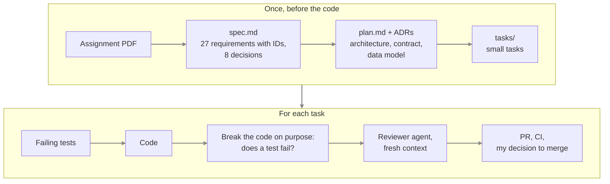
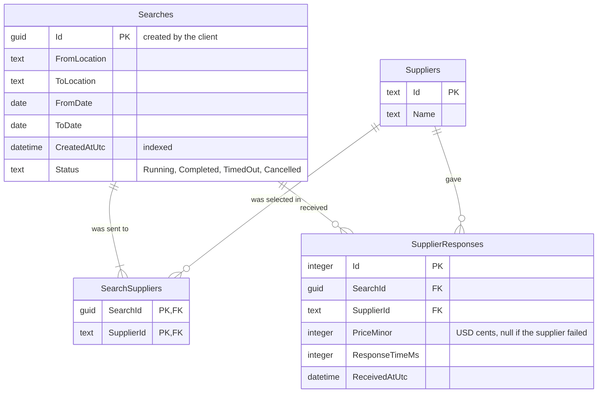

# PriceHunt

Shipping-price search across seven simulated suppliers. Prices appear as each supplier answers, cheapest first.
Every search is saved, and past prices can be filtered on the history screen.

Server: .NET 10, EF Core, SQLite. Client: Angular 22, Angular Material.

## How to run

Prerequisites: .NET 10 SDK, Node.js 22.22.3+ or 24.15+ (required by Angular 22). Both terminals start in the repo root.

```bash
# terminal 1: API on http://localhost:5080 (SQLite DB is created on first run)
dotnet run --project server/PriceHunt.Api

# terminal 2: UI on http://localhost:4142 (installs packages on first run)
npm start --prefix client
```

Ports 5080 and 4142 must be free. The API accepts browser requests only from `http://localhost:4142`.

Tests: `dotnet test --solution server/PriceHunt.sln` in the repo root, `npm test -- --watch=false` in `client/`.

## What to look at first

| If you have | Look at |
|-------------|---------|
| 5 minutes | Run it and search with all suppliers: it ends "Timed out" with "6 of 7 suppliers responded" because one supplier never answers (5 of 7 when the one that fails 30% of the time fails). Deselect Lantern Express and it ends "Completed". Start a second search while one runs. |
| 15 minutes | [`SearchOrchestrator.cs`](server/PriceHunt.Api/Search/SearchOrchestrator.cs): the 6 s limit, cancellation and failure isolation in one file. Its tests pin the races at the deadline listed in [T03b](docs/tasks/T03b-orchestrator-cancellation.md). |
| 30 minutes | One requirement from spec to test, see "One requirement, end to end" below. |

## How I worked: spec-driven development

I used spec-driven development (SDD) with Claude Code. The spec is written and agreed before the code. The spec, plan and tasks
are files in the repo, and the code is checked against them and not against a chat history.



| Step | What it is for |
|------|----------------|
| [spec.md](docs/spec.md) | Every requirement of the PDF has an ID (`SS3`, `SC6`, ...). Ambiguous points are decided here. |
| [plan.md](docs/plan.md), [adr/](docs/adr/) | Architecture, streaming contract, concurrency model. The risky parts were built first in throwaway spikes. |
| [tasks/](docs/tasks/) | One task is one session, one branch and one PR. A task lists its requirements, design and tests. |
| Failing tests first | The agent writes the tests from the task file and runs them before the code. The few that already pass are checked by breaking the code (next row). |
| Breaking the code on purpose | A passing test proves nothing if it can't fail. About 450 breaks are counted in [ai-usage.md](docs/ai-usage.md). A break that no test caught led to a new or a stricter test, or is listed in the PR with the reason. |
| Reviewer agent | A second agent with no knowledge of the chat compares the diff with the spec and the task. |
| [AGENTS.md](AGENTS.md), [.claude/](.claude/) | The rules, skills and permissions the agent works under. The settings deny the usual commands for pushing to `main`, force-pushing and merging. Every change after the initial commit came through a PR. |

### One requirement, end to end
`SS5`: "If the client cancels [...] the server must stop the work in progress."

1. [spec.md](docs/spec.md): `SS5`, and decision `I7` (the search is stored as `Cancelled`).
2. [plan.md](docs/plan.md#concurrency-model): which token is passed where, and what happens when it fires.
3. Tasks [T03b](docs/tasks/T03b-orchestrator-cancellation.md) (races) and [T05a](docs/tasks/T05a-search-stream.md) (HTTP).
4. Tests, for example `SS5_I7_ClientAbortsMidStream_SearchIsStoredAsCancelled`.
5. PRs [#10](https://github.com/l-Vladislav/pricehunt/pull/10) and [#12](https://github.com/l-Vladislav/pricehunt/pull/12), with each break tried, the test that caught it, and the few breaks no test can see.

Every requirement that can be tested automatically has at least one test that carries its ID.

### What this way of working found
- Before any code: a load test in a spike showed 10 parallel searches ending at 7.4 s instead of 6 s (see "SQLite has one writer").
- Breaking the code: three orchestrator tests were too weak (T03b), and four wrong history queries passed every test (T06).
- The reviewer agent: the location filter used `ToLower()`, so `Österreich` did not match itself (T06), and one unusual end date
  stopped the history filters for good (T10a).

## Streaming: how and why

`POST /api/search` answers with a Server-Sent Events stream, using `TypedResults.ServerSentEvents` from .NET 10. The client
reads it with `fetch` and cancels with `AbortController`.

| Event | Meaning |
|-------|---------|
| `started` | The search began. Carries the list of selected suppliers. |
| `quote` | A supplier answered with a price. |
| `supplier-failed` | A supplier failed. The others go on. |
| `ended` | The search is over, `completed` or `timedOut`, with the number of suppliers that gave a price. |

Why this way:
- Data flows in one direction only, so plain HTTP is enough.
- Cancellation needs no protocol of its own. Aborting the request fires `HttpContext.RequestAborted`, which is linked with the
  6 s timeout and passed to every supplier call. A new search, leaving the page and a closed tab all work the same way.
- The client creates the `searchId` and every event carries it, so a late event of an old search is dropped.

What I rejected: `EventSource` (GET only, and it reconnects, which would silently start the search again) and WebSockets
(two-way, with framing and cancellation to write by hand for one-way data).

The price is a small SSE parser in the client, and a search that lives only as long as its connection. That is fine for 6 s.
See [ADR-0001](docs/adr/0001-streaming-transport.md).

On the server, each selected supplier runs as its own task. One loop takes the results in completion order (`Task.WhenEach`),
saves each one and then streams it. Supplier tasks never touch the database.

## Database and table structure

SQLite through EF Core. The migrations run on startup, so `server/PriceHunt.Api/pricehunt.db` is created on the first run.



- `Searches` has one row per search. Its status is `Running` until the search ends.
- `SearchSuppliers` lists the suppliers the user selected. `Suppliers` is seeded with the seven.
- `SupplierResponses` has one row per answer, failures included. The history reads this table and leaves out the failures.

The diagram shows logical types: SQLite stores guids, dates and times as text. Prices are integer cents, so they are exact and sort
as plain integers. Times are UTC `DateTime`, because EF Core's SQLite provider can't sort by `DateTimeOffset`.

## Design decisions and trade-offs

### Where the assignment leaves room

| # | Question | Decision |
|---|----------|----------|
| I1 | What counts as "responded"? | Only a price. A failure doesn't count, so a search can end "Completed" with 5 of 6. If every supplier fails, the list stays empty. |
| I2 | Every search with all seven suppliers ends "Timed out". Is that a bug? | No. One supplier never responds, so `Completed` is possible only without it. A failing supplier causes no timeout: without the silent one the search still ends `Completed`, with fewer prices (I1). |
| I3 | What is stored for a supplier that did not answer in time? | No response row, only that it was asked. An answer still queued at the deadline behind the save of an earlier one is dropped too: not stored, not streamed, not counted. |
| I4 | Which date does the history filter use? | When the search ran, in the user's local days. |
| I5 | Are failures shown in the history? | No. They are stored, but the history shows only prices. |
| I6 | What is a location? | Free text, trimmed. The history matches it ignoring case. |
| I7 | What is stored when the client disconnects? | `Cancelled`, saved with a token that is not the request token, because that one is already cancelled. |
| I8 | "No special setup" with .NET 10 and Angular 22? | The .NET 10 SDK and Node.js are prerequisites. The run commands install the npm packages and create the database. |

The location filter is in the history API only (`fromLocation`, `toLocation`). The assignment lists it under the server and not among the screen's filters.

The full reasons and edge cases are in [spec.md](docs/spec.md#2-interpretations-of-ambiguous-points).

### Main decisions
A result is saved before it is streamed. Every price the user saw is in the history. The cost is that a slow write delays the event.

Angular Material for the UI. Forms, datepicker, table, sort headers and paginator come from the library, and sorting and paging
run in SQL. By hand: the animation that moves rows to their new places (FLIP) and the skeleton rows, which have the same height
as result rows, so the list doesn't jump. See [ADR-0002](docs/adr/0002-ui-components.md).

SQLite has one writer. Concurrent searches waited for its file lock: in a spike before implementation 10 parallel searches ended
at 7.4 s instead of 6 s, and with 100, 16 of 600 responses that arrived in time were lost. The recorder now queues its writes in
memory with one `SemaphoreSlim`, which brought that to 6.05 s and 600 of 600. The spike's code is not in the repo.
A server database would not need this, and it works only inside one process.

### Known limits
- If the server dies during a search, its status stays `Running`.
- Two requests that use one `searchId` at the same moment: the second one fails on the primary key instead of getting a 400.
- A timeout that fires while the last result is being saved ends as `Completed`, because every result arrived in time.
- The location match in the history ignores case for ASCII letters only (SQLite's `NOCASE`).

## Tests

112 on the server (about 5 s) and 155 on the client (about 6 s). The test code is more than twice the size of the product code.
That is on purpose. The agent wrote both the code and the tests, so a green run alone proves little. The tests follow the IDs
in the spec, and the code was broken on purpose to see them fail.

| Layer | What it proves |
|-------|----------------|
| HTTP integration (server) | The real path: endpoint, orchestrator, SSE, SQLite with real migrations. |
| Orchestrator | Exact races: a result during the deadline, a client that leaves during the last write. |
| Supplier | The hanging supplier ends only through its token, the failure rate, the delay and price range. |
| Client stream and store | SSE parsing, abort, order, progress, dropped events of an old search. |
| Client pages | Form, results, history filters, sorting and paging. |

No mocking library and no sleeps: fakes are small hand-written classes. On the server, time moves only through `FakeTimeProvider`.
Client tests drive the events by hand.

## What I would do differently
- Suppliers per route. Real carriers serve some routes and not others.
- A server database, such as PostgreSQL, for real load. The write queue would go away, and several instances could run.
- Indexes for the location filter, with the `NOCASE` collation, if the history grows.
- On startup, close the searches a crashed server left as `Running`.
- A few end-to-end tests in a real browser. The client tests run in jsdom, which has no layout.

## Where AI was used

Tool: Claude Code with the Claude Opus 5.5 model, in the terminal and in VS Code.

| Where | What AI did | What I did |
|-------|-------------|------------|
| Planning | Drafted the spec, plan, tasks and agent rules from my breakdown of the PDF. Wrote the CI workflow and the PR template. Compared UI options. Built the spikes. | Chose the architecture, the transport and the answers to the ambiguous points. |
| Code and tests | Wrote them, one task at a time, failing tests first. | Approved the steps, for some tasks in advance, and decided the open cases. |
| Checking | Broke the code on purpose, checked pages in Chrome, reviewed diffs with a second agent. | Reviewed and merged the PRs. |
| Documentation | Drafted this README, ADR-0002 and the PR descriptions. | Edited the docs and confirmed the first-person parts. |

[docs/ai-usage.md](docs/ai-usage.md) has a row per task.
