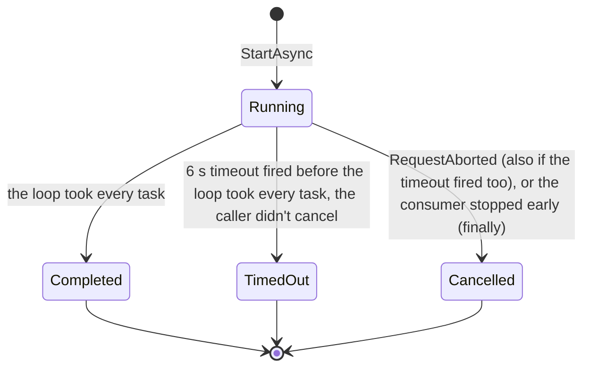
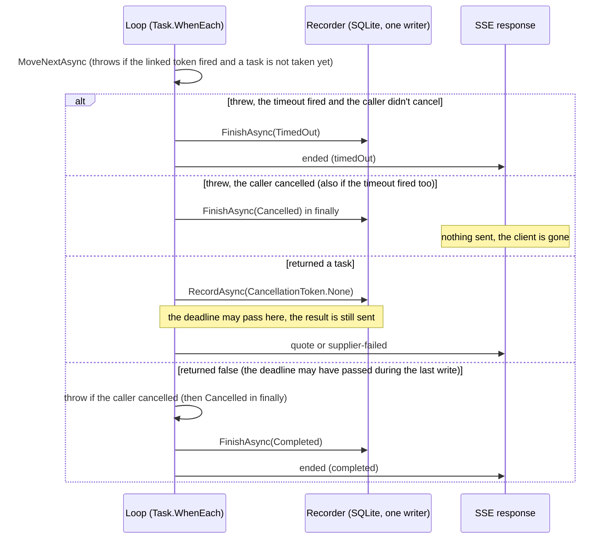

# PriceHunt: architecture and plan

Requirements: [spec.md](spec.md). Tasks: [tasks/](tasks/). Decisions: [adr/](adr/).

## Architecture

```
client (Angular 22)                         server (ASP.NET Core 10, Minimal API)
┌──────────────────────┐  POST /api/search   ┌──────────────────────────────────────────┐
│ SearchPage           │ ──────────────────► │ SearchEndpoint → SSE (text/event-stream) │
│  SearchStore(signals)│ ◄── SSE events ──── │   SearchOrchestrator                     │
│  SearchStreamClient  │   abort = cancel    │     linked CTS: RequestAborted + 6s      │
│   (fetch+AbortCtrl)  │                     │     Task per supplier → Task.WhenEach    │
├──────────────────────┤                     │     one loop: persist + yield            │
│ HistoryPage          │  GET /api/history   │   ISupplier ×7 (simulated)               │
│  table/sort/paging   │ ──────────────────► │ HistoryEndpoint → EF Core → SQLite       │
└──────────────────────┘                     └──────────────────────────────────────────┘
```

### Server layout (`server/PriceHunt.Api`)
- `Suppliers/`: `ISupplier`, `SimulatedSupplier`, `SupplierBehavior` (Normal / Flaky / Hanging), `SupplierCatalog`, `SupplierEndpoints`.
- `Search/`: `SearchRequest`, `SearchEvent` types, `SearchOrchestrator`, `SearchEndpoints`.
- `History/`: `HistoryQuery`, `HistoryEndpoints`.
- `Data/`: `AppDbContext`, entities. EF migrations go to the default `Migrations/` folder.
- `Program.cs`: wiring only.

### Concurrency model
1. Create a 6 s timeout CTS with `new CancellationTokenSource(TimeSpan.FromSeconds(6), timeProvider)` and link it to `HttpContext.RequestAborted`.
   The timer must belong to the timeout CTS: `CancelAfter` on a linked CTS runs on the system clock and ignores `FakeTimeProvider`.
2. Start one task per selected supplier. A task returns one result (price or failure, stamped with the response time and the time
   of the answer), or ends cancelled when the token fires first.
3. One loop enumerates `Task.WhenEach(tasks)` with the linked token, which returns tasks in completion order
   (by hand, because C# forbids `yield` inside a `try` with a `catch`; see T03a). For each task it persists the result first
   (with `CancellationToken.None`, so a started write is never cut off), then yields its event (`quote` or `supplier-failed`) to the HTTP stream.
   Supplier tasks never touch `DbContext`: a search's writes run one after another in the orchestrator's own flow. A stored result is always yielded.

   The loop takes no task after the token fired. While a task has not been taken yet, `MoveNextAsync` throws as soon as the
   token has fired, even if that task already completed, and the loop exits without waiting for pending suppliers. So a result
   that completes after the deadline is dropped, and so is one that completed in time but was still queued while the loop saved an earlier result (I1, I3).
   After the last task `MoveNextAsync` returns `false` without looking at the token.
4. Ending the search:
   - the loop took every task → `Completed`, also if the timeout fired during the last write (every result arrived in time);
   - the timeout fired before the loop took every task → `TimedOut`;
   - `RequestAborted` fired → `Cancelled`, also when the timeout fired too, and also during the last write: after the loop the caller's token is checked before
     `Completed` is written. The `OperationCanceledException` propagates to the caller (never caught or swallowed).

   Suppliers whose result the loop didn't take get no response row (I3).
5. The final status is written once, with `CancellationToken.None`. On normal completion it is written before `ended` is yielded,
   so the DB is final when the stream closes. A `finally` block also covers a consumer that stops enumerating early: it cancels
   the linked CTS, awaits all supplier tasks and writes `Cancelled` if no status was written yet.

6. SQLite allows one writer at a time. The recorder passes its writes through one `SemaphoreSlim(1, 1)`, so concurrent searches
   queue in the process instead of retrying on a locked database file (see "Checked by a spike").

Search status in the DB. `Running` is written by `StartAsync` (with `CancellationToken.None`, like every write) before any supplier
starts; the final status is written once.



One step of the loop. A result is either dropped before it is stored, or stored and then always sent.



### Streaming contract (SSE over `fetch`, see ADR-0001)
`POST /api/search` with body `{ searchId, fromLocation, toLocation, fromDate, toDate, supplierIds?: string[] }`.
The client creates `searchId` (`crypto.randomUUID()`) and the server uses it as the search's Id. So the client knows the id
before any event arrives and can drop events of an older search, `started` included (SC6).
The search dates on the wire (`fromDate`, `toDate`) are `yyyy-MM-dd`. The client builds them with `toIsoDate` (T07b).
The history bounds (`startDate`, `endDate`) are ISO 8601 UTC instants, see below.
The response is `text/event-stream`. Every payload carries a `searchId`. JSON is camelCase, enums included (`JsonStringEnumConverter` with camelCase).

| event | data |
|-------|------|
| `started` | `{ searchId, suppliers: [{id, name}] }` |
| `quote` | `{ searchId, supplierId, price, responseTimeMs }` (price in USD) |
| `supplier-failed` | `{ searchId, supplierId, responseTimeMs }` |
| `ended` | `{ searchId, status: "completed" \| "timedOut", responded, total }` |

The server never sends `Cancelled`, because the client is gone by then. That status exists only in the DB.

`GET /api/suppliers` returns `[{ id, name }]`.
`GET /api/history?startDate&endDate&supplierIds=a&supplierIds=b&fromLocation&toLocation&sortBy&sortDir&page&pageSize`
returns `{ items: [...], total, page, pageSize }`. `startDate` (inclusive) and `endDate` (exclusive) are UTC instants such as
`2026-11-22T22:00:00.000Z`: the client sends the local midnight of the first day and of the day after the last day (I4). An item is
`{ id, date, fromLocation, toLocation, supplierName, price, responseTimeMs }`: `date` is the search timestamp (I4), `price` is USD or `null` for a failure (I5). `sortBy` is one of `date|route|supplier|price|responseTime` (whitelist).

### Data model (SQLite)
- `Suppliers` (Id PK text, Name). Seeded with `HasData`.
- `Searches` (Id PK guid, FromLocation, ToLocation, FromDate, ToDate, CreatedAtUtc, Status). Status: `Running` while streaming, then `Completed`/`TimedOut`/`Cancelled`.
- `SearchSuppliers` (SearchId FK, SupplierId FK, PK both). Records the selected suppliers.
- `SupplierResponses` (Id PK, SearchId FK, SupplierId FK, PriceMinor? (USD cents, null = the supplier failed, I5), ResponseTimeMs, ReceivedAtUtc).
  Indexes: EF's default ones on the foreign keys, plus `Searches(CreatedAtUtc)` for the history date filter (I4).

## Checked by a spike
Before T01 the risky parts of this plan were built once in a throwaway copy (not committed) with integration tests and a load test.
Confirmed: the orchestrator design (manual enumeration, `[EnumeratorCancellation]`, the `finally`, late results dropped, `Cancelled`
written once), `SseItem<object>` with derived fields and camelCase enums, abort through `TestServer`, built-in validation on records
and on `[AsParameters]` with `IValidatableObject`, the in-memory SQLite factory, the UTC converter, `HasData`, and null-last price sorting in SQL.
The first spike's loop checked the token after each `MoveNextAsync`. The current loop has no such check and relies on how `Task.WhenEach`
handles cancellation. That was checked later on .NET 10 with a console app: `MoveNextAsync` throws after the token fired while a
task is not taken yet, even a completed one, and returns `false` after the last task without looking at the token.
The first spike found and fixed in the tasks:
- Concurrent searches waited seconds for the SQLite write lock. With 10 searches at once `ended` came at 7.4 s instead of 6 s;
  with 100, 16 of 600 responses that arrived in time were lost. One in-process writer (`SemaphoreSlim`) brought it to 6.05 s
  and 600 of 600, and 400 searches at once still end by 6.7 s. See T04 and the README trade-offs.
- A `[AsParameters]` class with `int Page { get; set; } = 1` makes `page` required. T06 uses a record with default values.
- Time-advance and factory-disposal rules for tests (`AGENTS.md`, "Testing rules").

A second spike, after the task files were final, built T03a, T03b, T06's date filter and T08a's store from the task text and
broke the code on purpose, one change at a time. Every listed test passed on the right code, and each break that was tried made a
test fail (e.g. `StartAsync` inside the `try`, a token check in the loop, a write with the linked token, time
stamped in the loop, `catchError` outside `switchMap`). It led to `Cancel()` instead of `CancelAsync()` in the `finally` (T03a),
the EF package version rule and the xUnit1051 rule (`AGENTS.md`), and the default random sequence (T04).

## Tasks

Status: `[ ]` todo · `[~]` in progress · `[x]` done. Tasks go in order, one PR each. A task too big for one PR is split into subtasks (see `AGENTS.md`).

| ID | Task | Reqs | Status |
|----|------|------|--------|
| [T01](tasks/T01-foundation.md) | Foundation: CORS, supplier catalog and endpoint, test factory | S1, D1, D3 | [x] |
| [T02](tasks/T02-suppliers.md) | Simulated suppliers | S1–S4 | [x] |
| [T03a](tasks/T03a-orchestrator-core.md) | Search orchestrator: stream, timeout, isolation | SS1–SS4, P2, I1–I3 | [~] |
| [T03b](tasks/T03b-orchestrator-cancellation.md) | Search orchestrator: cancellation, races at the deadline | SS3, SS5, P1, I1, I3, I7 | [ ] |
| [T04](tasks/T04-persistence.md) | EF Core model, auto-migrate, recording searches and responses | P1–P3, I3, I5, I7 | [ ] |
| [T05a](tasks/T05a-search-stream.md) | SSE search endpoint: streaming, timeout, cancellation | SS2–SS5, SC6, I1, I2, I7 | [ ] |
| [T05b](tasks/T05b-search-validation.md) | SSE search endpoint: validation, trimming | SS1, I6 | [ ] |
| [T06](tasks/T06-history-endpoint.md) | History endpoint: filters, sorting, paging | HS1, HS2, I4–I6 | [ ] |
| [T07](tasks/T07-client-stream.md) | Client SSE-over-fetch stream client | SC2, SC6 | [ ] |
| [T07b](tasks/T07b-material-setup.md) | Angular Material setup, date adapter, `toIsoDate` (ADR-0002) | — | [ ] |
| [T08a](tasks/T08a-search-store.md) | Search store: sorted results, progress, stale guard | SC2, SC3, SC4, SC5, SC6, SS5, I1 | [ ] |
| [T08b](tasks/T08b-search-page.md) | Search page: form, result list, progress line | SC1, SC2, SC4, SC5, SC6 | [ ] |
| [T09](tasks/T09-no-flicker.md) | Smooth re-ordering (FLIP) | SC4 | [ ] |
| [T10a](tasks/T10a-history-filters.md) | History page: route, API client, filters, table | HC1, HC2, I4, I5 | [ ] |
| [T10b](tasks/T10b-history-table.md) | History page: sorting, paging, skeleton | HC2 | [ ] |
| [T11](tasks/T11-readme-release.md) | README, clean-clone verification | SS6, D1, D2, D4 | [ ] |
